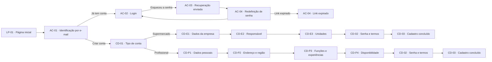
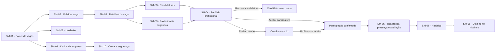
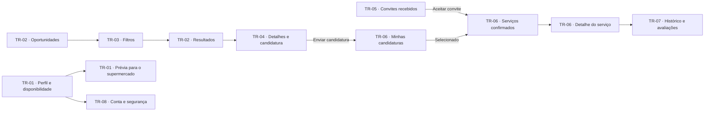
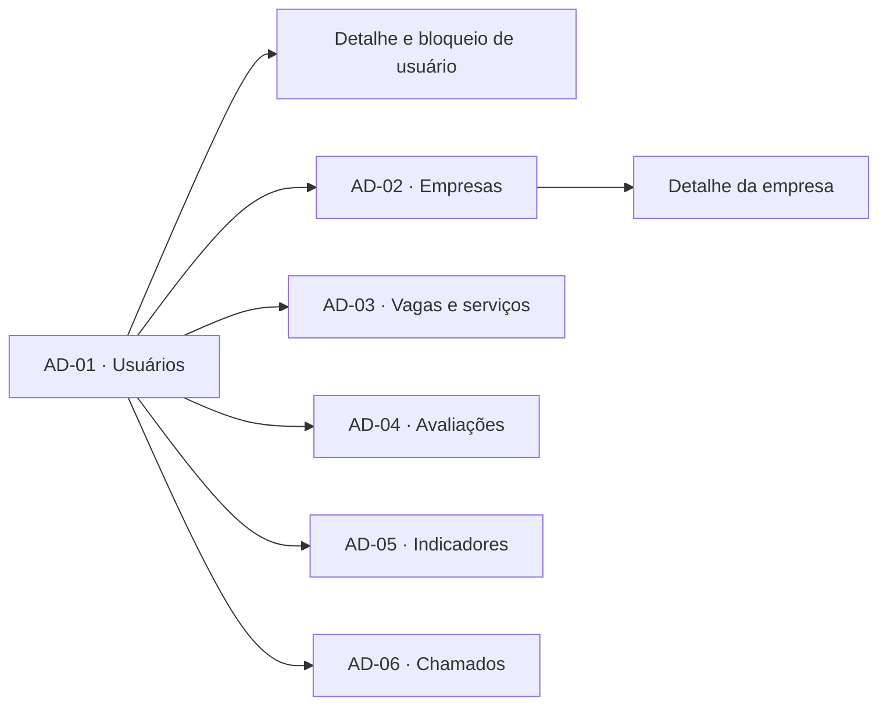

<div align="center">

# SuperForça

### Design das jornadas do MVP


**Conectando supermercados a profissionais para demandas sazonais e emergenciais.**

[Abrir o protótipo no Figma](https://www.figma.com/design/sucf2wudh5FRUMSHeWhfTi/SuperFor%C3%A7a-%E2%80%94-Telas-do-MVP?node-id=0-1)

</div>

---

## ✨ Sobre o projeto

O **SuperForça** é a proposta de uma plataforma digital para aproximar supermercados de São Paulo e profissionais disponíveis para serviços temporários. O MVP explora as jornadas de quem publica oportunidades e de quem busca trabalho, considerando função, qualificação quando necessária, proximidade, disponibilidade e valor do serviço.

Este repositório documenta o **design das interfaces no Figma**. Não contém a aplicação implementada nem os arquivos-fonte do protótipo.

## 🎯 Objetivos

- Apoiar supermercados no atendimento a demandas sazonais e emergenciais.
- Ajudar profissionais a encontrar oportunidades compatíveis com seu perfil e disponibilidade.
- Centralizar publicação de vagas, candidaturas, convites, confirmação de participação e avaliações.

## 🧭 Jornadas do MVP

O arquivo atual do Figma reúne **134 frames em 10 jornadas**, além de 19 frames/componentes reutilizáveis e 25 frames de toasts e confirmações. O material está apresentado em desktop, com referência de 1280 px. Os diagramas abaixo resumem os caminhos principais; telas de erro, listas vazias, modais e menus abertos são estados alternativos das respectivas jornadas. Os índices em [`telas/`](telas/) detalham cada fluxo, suas siglas, estados e uma sequência de interação.

| # | Jornada | Principais etapas |
|---|---|---|
| 1 | **Entrada e acesso** | Página inicial, identificação por e-mail, login e recuperação de senha |
| 2 | **Cadastro do supermercado** | Tipo de conta, empresa, responsável, unidades, senha e conclusão |
| 3 | **Supermercado: publicar e preencher vagas** | Painel, publicação, candidaturas, sugestões, seleção e realização |
| 4 | **Supermercado: histórico e unidades** | Vagas concluídas ou encerradas, detalhes e gestão de unidades |
| 5 | **Supermercado: minha conta** | Dados da empresa, conta e segurança |
| 6 | **Cadastro do profissional** | Dados pessoais, endereço e região, funções, experiências e disponibilidade |
| 7 | **Profissional: encontrar vagas e se candidatar** | Oportunidades, filtros, detalhes e candidatura |
| 8 | **Profissional: convites, serviços e histórico** | Convites, candidaturas, serviços confirmados e avaliações |
| 9 | **Profissional: minha conta** | Perfil, disponibilidade, prévia para o supermercado e segurança |
| 10 | **Administrador** | Gestão de usuários, empresas, vagas e serviços, avaliações, indicadores e chamados |

### Acesso e cadastro



### Jornada do supermercado



### Jornada do profissional



### Jornada do administrador



O Figma também inclui telas de suporte para supermercado (SM-11) e profissional (TR-09), e uma área administrativa de chamados (AD-06), além de estados de bloqueio e reativação. Consulte a [análise de cobertura e lacunas](analise-figma.md) e o [protótipo](https://www.figma.com/design/sucf2wudh5FRUMSHeWhfTi/SuperFor%C3%A7a-%E2%80%94-Telas-do-MVP?node-id=0-1) para ver os frames e estados.

## 🎨 Identidade visual

O design combina uma linguagem **brutalista**, com contraste preto e branco, bordas espessas, cantos retos e sombras duras deslocadas em 4 px. Os títulos usam **Archivo Black** e os textos, **Inter**.

| Uso | Cor |
|---|---|
| Cabeçalhos e ações principais | Verde `#003E1F` |
| Destaques, como item ativo e valor da vaga | Amarelo `#FFC300` |
| Ações negativas | Vermelho `#C1121F` |
| Vaga aberta | Azul `#2A6F97` |
| Vaga preenchida | Mostarda `#E9C46A` |
| Vaga a registrar | Terracota `#E76F51` |
| Vaga concluída | Verde `#226F54` |
| Vaga encerrada | Vermelho `#C1121F` |

O arquivo do Figma também agrupa componentes reutilizáveis — botões, campos, selos de status, abas, cabeçalhos, cards e notificações — para manter as telas consistentes.

## 📌 Escopo e limites

- O Figma atual também inclui telas de **administrador** (AD-01 a AD-06), embora elas não apareçam no resumo anterior em PDF.
- As telas descritas estão em formato desktop, com largura de referência de 1280 px. Uma versão mobile não está definida no escopo documentado.
- Pagamentos são realizados fora da plataforma no MVP.
- O foco inicial é a cidade de São Paulo, com possibilidade de expansão posterior para a Grande São Paulo.

## 📁 Materiais do repositório

O arquivo nativo do Figma está salvo como `index.fig`. O ZIP de origem fornece
uma imagem PNG por seção (não por frame); cada pasta em `telas/` contém essa
exportação e um `index.md` com diagrama de sequência, explicação das siglas e
descrição das telas/estados. As pastas `componentes/` e
`toasts-confirmacoes/` documentam elementos compartilhados sem tratá-los como
jornadas independentes.

```text
.
├── index.fig
├── README.md
├── LICENSE
├── analise-figma.md
├── canvas-superforca.md
├── pre-projeto.md
└── telas/
    ├── 01-entrada-acesso/
    ├── 02-cadastro-supermercado/
    ├── 03-publicar-preencher-vagas/
    ├── 04-historico-unidades/
    ├── 05-conta-supermercado/
    ├── 06-cadastro-profissional/
    ├── 07-encontrar-vagas/
    ├── 08-convites-servicos-historico/
    ├── 09-conta-profissional/
    ├── 10-administrador/
    ├── componentes/
    └── toasts-confirmacoes/
```

Os índices de cada pasta são o ponto de entrada para a documentação daquele
fluxo.

## 🎓 Contexto acadêmico

Projeto acadêmico da disciplina **Garantia da Qualidade de Software**, do curso de Ciência da Computação da **Universidade Anhembi Morumbi**.

## 📄 Licença

Distribuído sob a licença [MIT](LICENSE).
