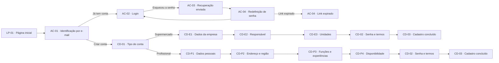
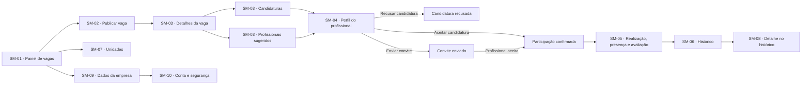
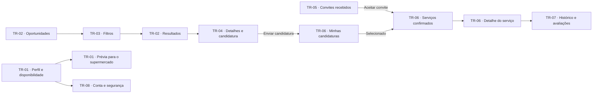
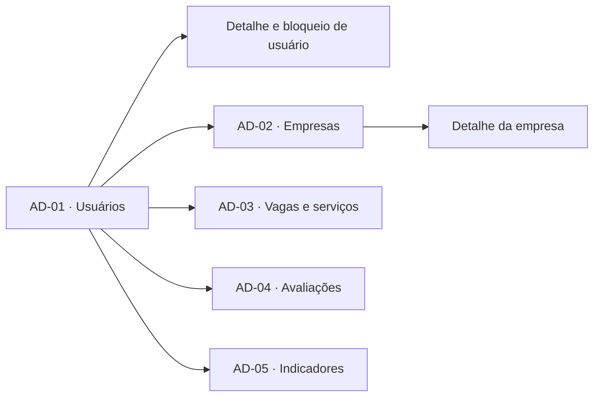

<div align="center">

# SuperForça

### Design das jornadas do MVP


**Conectando supermercados a profissionais para demandas sazonais e emergenciais.**

[Abrir o protótipo no Figma](https://www.figma.com/design/sucf2wudh5FRUMSHeWhfTi/SuperFor%C3%A7a-%E2%80%94-Telas-do-MVP?node-id=0-1)

</div>

---

## ✨ Sobre o projeto

O **SuperForça** é a proposta de uma plataforma digital para aproximar supermercados de São Paulo e profissionais disponíveis para serviços temporários. O MVP explora as jornadas de quem publica oportunidades e de quem busca trabalho, considerando função, qualificação quando necessária, proximidade, disponibilidade e valor do serviço.

Este repositório documenta o **design das interfaces no Figma**. Não contém a aplicação implementada nem os arquivos-fonte do protótipo.

## 🎯 Objetivos

- Apoiar supermercados no atendimento a demandas sazonais e emergenciais.
- Ajudar profissionais a encontrar oportunidades compatíveis com seu perfil e disponibilidade.
- Centralizar publicação de vagas, candidaturas, convites, confirmação de participação e avaliações.

## 🧭 Jornadas do MVP

O arquivo atual do Figma organiza cerca de 70 frames desktop (1280 px) em **10 jornadas**, além da seção de componentes. Os diagramas abaixo resumem os caminhos principais; telas de erro, listas vazias, modais e menus abertos são estados alternativos das respectivas jornadas.

| # | Jornada | Principais etapas |
|---|---|---|
| 1 | **Entrada e acesso** | Página inicial, identificação por e-mail, login e recuperação de senha |
| 2 | **Cadastro do supermercado** | Tipo de conta, empresa, responsável, unidades, senha e conclusão |
| 3 | **Supermercado: publicar e preencher vagas** | Painel, publicação, candidaturas, sugestões, seleção e realização |
| 4 | **Supermercado: histórico e unidades** | Vagas concluídas ou encerradas, detalhes e gestão de unidades |
| 5 | **Supermercado: minha conta** | Dados da empresa, conta e segurança |
| 6 | **Cadastro do profissional** | Dados pessoais, endereço e região, funções, experiências e disponibilidade |
| 7 | **Profissional: encontrar vagas e se candidatar** | Oportunidades, filtros, detalhes e candidatura |
| 8 | **Profissional: convites, serviços e histórico** | Convites, candidaturas, serviços confirmados e avaliações |
| 9 | **Profissional: minha conta** | Perfil, disponibilidade, prévia para o supermercado e segurança |
| 10 | **Administrador** | Gestão de usuários, empresas, vagas e serviços, avaliações e indicadores |

### Acesso e cadastro



### Jornada do supermercado



### Jornada do profissional



### Jornada do administrador



O Figma atual inclui, portanto, telas administrativas — uma atualização em relação ao resumo em PDF disponível nos materiais do projeto. Consulte o [protótipo](https://www.figma.com/design/sucf2wudh5FRUMSHeWhfTi/SuperFor%C3%A7a-%E2%80%94-Telas-do-MVP?node-id=0-1) para ver todos os frames e estados.

## 🎨 Identidade visual

O design combina uma linguagem **brutalista**, com contraste preto e branco, bordas espessas, cantos retos e sombras duras deslocadas em 4 px. Os títulos usam **Archivo Black** e os textos, **Inter**.

| Uso | Cor |
|---|---|
| Cabeçalhos e ações principais | Verde `#003E1F` |
| Destaques, como item ativo e valor da vaga | Amarelo `#FFC300` |
| Ações negativas | Vermelho `#C1121F` |
| Vaga aberta | Azul `#2A6F97` |
| Vaga preenchida | Mostarda `#E9C46A` |
| Vaga a registrar | Terracota `#E76F51` |
| Vaga concluída | Verde `#226F54` |
| Vaga encerrada | Vermelho `#C1121F` |

O arquivo do Figma também agrupa componentes reutilizáveis — botões, campos, selos de status, abas, cabeçalhos, cards e notificações — para manter as telas consistentes.

## 📌 Escopo e limites

- O Figma atual também inclui telas de **administrador** (AD-01 a AD-05), embora elas não apareçam no resumo anterior em PDF.
- As telas descritas estão em formato desktop, com largura de referência de 1280 px. Uma versão mobile não está definida no escopo documentado.
- Pagamentos são realizados fora da plataforma no MVP.
- O foco inicial é a cidade de São Paulo, com possibilidade de expansão posterior para a Grande São Paulo.

## 📁 Estrutura-alvo do repositório

A árvore abaixo é uma **proposta de organização** para os materiais do projeto. No momento, este repositório contém apenas `README.md` e `LICENSE`; os arquivos listados como alvo ainda precisam ser exportados, convertidos ou adicionados.

O arquivo nativo exportado do Figma usa a extensão `.fig`, então o nome sugerido é `index.fig`. Cada frame pode ser exportado como PNG para `telas/`, usando o identificador da tela no nome do arquivo. O PDF do Canvas e o pré-projeto em Markdown ficam na raiz.

```text
.
├── index.fig
├── README.md
├── LICENSE
├── canvas-superforca.pdf
├── pre-projeto.md
└── telas/
    ├── 01-LP-01-pagina-inicial.png
    ├── 01-AC-01-identificacao-por-email.png
    ├── 01-AC-02-login.png
    ├── 02-CD-01-tipo-de-conta.png
    ├── 02-CD-E1-dados-da-empresa.png
    ├── 03-SM-01-painel-de-vagas.png
    ├── 03-SM-02-publicar-vaga.png
    ├── 04-SM-06-historico.png
    ├── 05-SM-09-dados-da-empresa.png
    ├── 06-CD-P1-dados-pessoais.png
    ├── 06-CD-P4-disponibilidade.png
    ├── 07-TR-02-oportunidades.png
    ├── 08-TR-05-convites-recebidos.png
    ├── 09-TR-01-perfil-e-disponibilidade.png
    ├── 10-AD-01-usuarios.png
    ├── 10-AD-05-indicadores.png
    └── ... (demais telas e estados do Figma)
```

## 🎓 Contexto acadêmico

Projeto acadêmico da disciplina **Garantia da Qualidade de Software**, do curso de Ciência da Computação da **Universidade Anhembi Morumbi**.

## 📄 Licença

Distribuído sob a licença [MIT](LICENSE).
