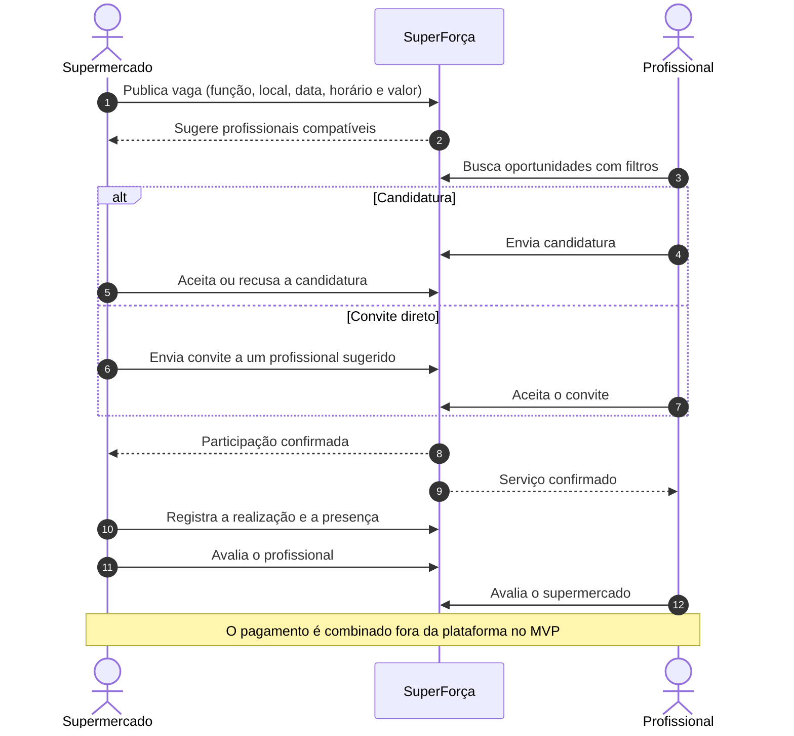
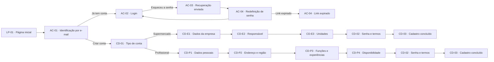
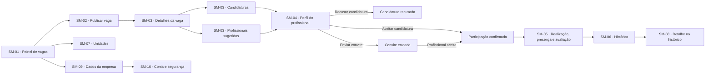
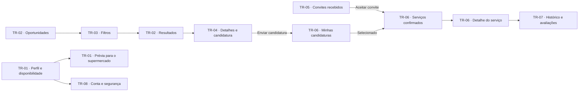
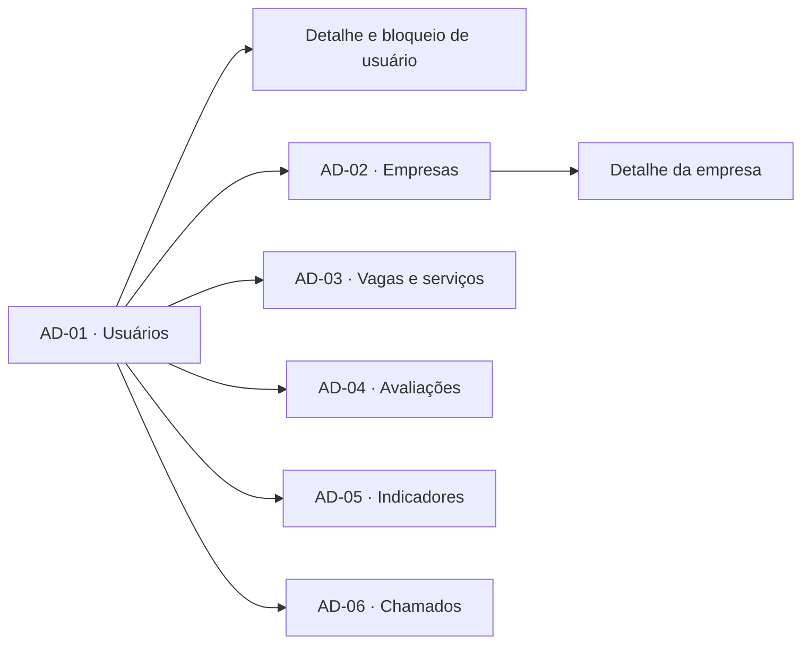

# 🛒 SuperForça — Design das Jornadas do MVP


> Conectando supermercados a profissionais para demandas sazonais e emergenciais.

O **SuperForça** é um projeto acadêmico da disciplina **Garantia da Qualidade de Software**, do curso de **Ciência da Computação** da **Universidade Anhembi Morumbi**, desenvolvido no formato da **UC HUB**. É a proposta de uma plataforma digital que aproxima supermercados de São Paulo e profissionais disponíveis para serviços temporários, considerando função, qualificação quando necessária, proximidade, disponibilidade e valor do serviço.

Este repositório documenta o **design das interfaces do MVP no Figma**, junto com o Canvas e o Pré-projeto da UC HUB. Não contém a aplicação implementada.

🔗 **Protótipo:** [abrir no Figma](https://www.figma.com/design/sucf2wudh5FRUMSHeWhfTi/SuperFor%C3%A7a-%E2%80%94-Telas-do-MVP?node-id=0-1)



---

## ✨ O Problema

Supermercados enfrentam falta de mão de obra e picos de demanda sazonais e emergenciais, mas a busca por profissionais temporários costuma acontecer de forma informal:

- **Busca fragmentada**: profissionais são encontrados por indicações, contatos pessoais e WhatsApp.
- **Seleção sem histórico**: não há um registro centralizado de experiências, qualificações e avaliações de serviços anteriores.
- **Oportunidades pouco visíveis**: trabalhadores que querem ganhos extras em folgas ou horários ociosos não têm um canal focado no setor.

## 🚀 A Solução

O SuperForça centraliza a publicação de oportunidades e a busca por profissionais:

- **Supermercados** publicam demandas, consultam profissionais sugeridos por compatibilidade, recebem candidaturas e enviam convites diretos.
- **Profissionais** pesquisam oportunidades compatíveis com seu perfil, ou ampliam a busca para outras funções respeitando os requisitos, e se candidatam.
- **Histórico e avaliações** de ambas as partes apoiam seleções futuras e o acompanhamento da operação.
- **Administradores** gerenciam usuários, empresas, vagas, avaliações, indicadores e chamados de suporte.

## 🎯 Diferenciais

- **Foco geográfico e setorial**: desenhado para supermercados da cidade de São Paulo, diferente das plataformas generalistas de trabalho temporário analisadas no [pré-projeto](pre-project.md).
- **Compatibilidade multicritério**: função, qualificação, proximidade, disponibilidade e valor do serviço.
- **Dois caminhos de contratação**: candidatura do profissional ou convite direto do supermercado.
- **Avaliação nos dois sentidos**: supermercados avaliam profissionais e profissionais avaliam supermercados.
- **Design documentado frame a frame**: 172 frames exportados em PNG, com índice por jornada contendo diagrama de sequência, siglas e estados.

---

## 🛠️ Stack Tecnológica

| Camada | Tecnologia |
|---|---|
| **Design de interface** | Figma (arquivo nativo `index.fig`) |
| **Formato das telas** | Desktop, com largura de referência de 1280 px |
| **Tipografia** | Archivo Black (títulos) e Inter (textos) |
| **Exportações** | PNG por frame e por seção, em [`ui-design/`](ui-design/) |
| **Documentação** | Markdown com diagramas Mermaid |

---

## 🏛️ Arquitetura da Informação

### 👥 Perfis de usuário

| Perfil | Quem é | O que faz |
| :--- | :--- | :--- |
| **Supermercado** | RH, gestores de loja e responsáveis pelas demandas | Publica vagas, seleciona profissionais, registra a realização e avalia os serviços |
| **Profissional** | Pessoas em busca de ganhos extras | Cadastra experiências, qualificações e disponibilidade, se candidata e responde a convites |
| **Administrador** | Equipe do SuperForça | Gerencia cadastros, acompanha a operação e atende chamados de suporte |

### Siglas das telas

| Sigla | Área |
| :--- | :--- |
| `LP` | Página inicial (landing page) |
| `AC` | Acesso: identificação, login e recuperação de senha |
| `CD` | Cadastro (`CD-E*` supermercado, `CD-P*` profissional) |
| `SM` | Área do supermercado |
| `TR` | Área do profissional (trabalhador) |
| `AD` | Área do administrador |

---

## 🗺️ Telas & Jornadas

O arquivo do Figma reúne **172 frames exportáveis**: 134 em 10 jornadas, 13 de componentes e 25 de toasts e confirmações. A seção de componentes também contém seis símbolos reutilizáveis. Cada frame tem um PNG individual em [`ui-design/`](ui-design/), além das exportações gerais por seção.

| # | Jornada | Principais etapas |
|---|---|---|
| 1 | [**Entrada e acesso**](ui-design/01-entrada-acesso/index.md) | Página inicial, identificação por e-mail, login e recuperação de senha |
| 2 | [**Cadastro do supermercado**](ui-design/02-cadastro-supermercado/index.md) | Tipo de conta, empresa, responsável, unidades, senha e conclusão |
| 3 | [**Supermercado: publicar e preencher vagas**](ui-design/03-publicar-preencher-vagas/index.md) | Painel, publicação, candidaturas, sugestões, seleção e realização |
| 4 | [**Supermercado: histórico e unidades**](ui-design/04-historico-unidades/index.md) | Vagas concluídas ou encerradas, detalhes e gestão de unidades |
| 5 | [**Supermercado: minha conta**](ui-design/05-conta-supermercado/index.md) | Dados da empresa, conta e segurança |
| 6 | [**Cadastro do profissional**](ui-design/06-cadastro-profissional/index.md) | Dados pessoais, endereço e região, funções, experiências e disponibilidade |
| 7 | [**Profissional: encontrar vagas e se candidatar**](ui-design/07-encontrar-vagas/index.md) | Oportunidades, filtros, detalhes e candidatura |
| 8 | [**Profissional: convites, serviços e histórico**](ui-design/08-convites-servicos-historico/index.md) | Convites, candidaturas, serviços confirmados e avaliações |
| 9 | [**Profissional: minha conta**](ui-design/09-conta-profissional/index.md) | Perfil, disponibilidade, prévia para o supermercado e segurança |
| 10 | [**Administrador**](ui-design/10-administrador/index.md) | Gestão de usuários, empresas, vagas e serviços, avaliações, indicadores e chamados |

### Acesso e cadastro



### Jornada do supermercado



### Jornada do profissional



### Jornada do administrador



O Figma também inclui telas de suporte para supermercado (SM-11) e profissional (TR-09), além de estados de bloqueio e reativação. Os elementos compartilhados estão documentados em [`componentes/`](ui-design/componentes/) e [`toasts-confirmacoes/`](ui-design/toasts-confirmacoes/).

---

## 🎨 Identidade Visual

O design combina uma linguagem **brutalista**, com contraste preto e branco, bordas espessas, cantos retos e sombras duras deslocadas em 4 px. Os títulos usam **Archivo Black** e os textos, **Inter**.

| Uso | Cor |
|---|---|
| Cabeçalhos e ações principais | Verde `#003E1F` |
| Destaques, como item ativo e valor da vaga | Amarelo `#FFC300` |
| Ações negativas | Vermelho `#C1121F` |
| Vaga aberta | Azul `#2A6F97` |
| Vaga preenchida | Mostarda `#E9C46A` |
| Vaga a registrar | Terracota `#E76F51` |
| Vaga concluída | Verde `#226F54` |
| Vaga encerrada | Vermelho `#C1121F` |

O arquivo do Figma agrupa componentes reutilizáveis — botões, campos, selos de status, abas, cabeçalhos, cards e notificações — para manter as telas consistentes.

---

## 📁 Estrutura do Projeto

```text
software-quality-assurance/
├── canvas.md                       # Canvas Adaptado UC HUB
├── pre-project.md                  # Pré-projeto UC HUB
├── notice.md                       # Orientações da UC HUB
├── index.fig                       # Arquivo nativo do Figma
├── ui-design/
│   ├── 01-entrada-acesso/
│   │   ├── index.md                # Diagrama de sequência, siglas e descrição do fluxo
│   │   ├── entrada-acesso.png      # Exportação da seção completa
│   │   ├── LP-01 · Página inicial.png
│   │   └── ...                     # Um PNG por frame, com o nome do próprio frame
│   ├── 02-cadastro-supermercado/
│   ├── 03-publicar-preencher-vagas/
│   ├── 04-historico-unidades/
│   ├── 05-conta-supermercado/
│   ├── 06-cadastro-profissional/
│   ├── 07-encontrar-vagas/
│   ├── 08-convites-servicos-historico/
│   ├── 09-conta-profissional/
│   ├── 10-administrador/
│   ├── componentes/
│   └── toasts-confirmacoes/
├── LICENSE
└── README.md
```

Em `ui-design/` estão os 172 PNGs individuais dos frames exportáveis, além de 12 PNGs que mostram as seções completas.

---

## ⚡ Como Explorar

1. **Online:** abra o [protótipo no Figma](https://www.figma.com/design/sucf2wudh5FRUMSHeWhfTi/SuperFor%C3%A7a-%E2%80%94-Telas-do-MVP?node-id=0-1) para navegar pelos frames e estados.
2. **Arquivo local:** importe o `index.fig` no Figma (*Menu → File → Import*) para ter uma cópia editável.
3. **Pelo repositório:** comece pelo `index.md` da jornada desejada em [`ui-design/`](ui-design/); cada índice tem o diagrama de sequência, as siglas e os PNGs do fluxo.

---

## 📚 Documentação do Projeto

| Documento | Conteúdo |
|---|---|
| [`canvas.md`](canvas.md) | Canvas Adaptado UC HUB: usuários, objetivo, contribuições, dados, riscos e referências |
| [`pre-project.md`](pre-project.md) | Pré-projeto UC HUB: concorrentes, usuários, atuação sobre o problema, interfaces e sequência de funcionamento |
| [`notice.md`](notice.md) | Orientações da UC HUB: entregáveis, cronograma e regras de entrega |
| [`ui-design/*/index.md`](ui-design/) | Documentação de cada jornada, com diagrama de sequência, siglas e estados |

---

## 📌 Escopo & Limitações

- **Somente design**: o repositório não contém a aplicação implementada nem código-fonte.
- **Desktop**: as telas estão em formato desktop, com largura de referência de 1280 px; uma versão mobile não faz parte do escopo documentado.
- **Pagamentos fora da plataforma**: no MVP, o valor do serviço é combinado e pago fora do SuperForça.
- **Atuação inicial em São Paulo**: o foco é a cidade de São Paulo, com possibilidade de expansão posterior para a Grande São Paulo.
- **Hipóteses a validar**: o fluxo atual de contratação descrito no pré-projeto é uma proposta a confirmar em entrevistas com supermercados.

---

## 🎓 Contexto Acadêmico

Projeto acadêmico da disciplina **Garantia da Qualidade de Software**, do curso de **Ciência da Computação** da **Universidade Anhembi Morumbi**, desenvolvido no formato da **UC HUB (Ânima Lab HUB 2026/2)**: o Canvas e o Pré-projeto compõem a Sprint 1, e as telas do MVP servem de base para a prototipação. As regras de entrega estão resumidas em [`notice.md`](notice.md).

---

## 🤝 Contribuindo

Sugestões de melhoria nas telas ou na documentação são bem-vindas:

1. Faça um Fork do projeto
2. Crie uma branch para a sua sugestão (`git checkout -b docs/nome-da-sugestao`)
3. Faça o commit das suas alterações (`git commit -m 'docs: descreve a sugestão'`)
4. Envie para o repositório remoto (`git push origin docs/nome-da-sugestao`)
5. Abra um **Pull Request** detalhando as alterações

---

## 📄 Licença

Distribuído sob a licença MIT. Veja [`LICENSE`](LICENSE) para mais detalhes.

---
Feito com ❤️ por [@matheusnascimentods](https://github.com/matheusnascimentods)
