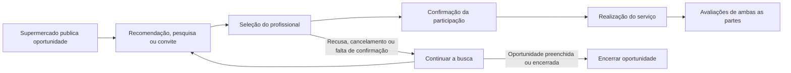

# Pré-projeto UC HUB — SuperForça

> Transcrição organizada em Markdown do pré-projeto em PDF. Os nomes, RAs e e-mails dos integrantes foram omitidos nesta versão. As figuras do PDF foram descritas em texto quando havia informação correspondente no documento.

## Apresentação

**SuperForça** é a proposta de um aplicativo para conectar supermercados a profissionais em demandas sazonais e emergenciais. A atuação inicial será na cidade de São Paulo, com possibilidade de expansão posterior para a Grande São Paulo.

## 1. Produtos concorrentes ou similares

O SuperForça está sendo desenhado para atender às demandas sazonais e emergenciais dos supermercados da cidade de São Paulo, conectando estabelecimentos a profissionais disponíveis conforme função, qualificação quando necessária, proximidade, disponibilidade e valor do serviço.

O diferencial proposto é o foco geográfico e setorial. Isso não significa que os concorrentes deixem de atender supermercados ou essas localidades. A comparação considera informações públicas divulgadas pelas empresas em **15 de outubro de 2026**. A ausência de descrição pública de um recurso não comprova sua inexistência; as contribuições abaixo são propostas de escopo a avaliar durante o desenvolvimento e os testes.

| Aplicativo e responsável | O que faz e pontos fortes | Limitações identificadas nas fontes consultadas | Contribuição proposta pelo SuperForça | Fora do MVP do SuperForça |
|---|---|---|---|---|
| **iWof** — iWof Tecnologia Ltda. ([site](https://www.iwof.com.br/)) | Conecta empresas e profissionais; divulga oportunidades de serviços e renda extra; informa recebimento por atividades; atua em supermercados. | As páginas consultadas não detalham os pesos e critérios de recomendação. | Foco em demandas sazonais e emergenciais de supermercados da capital paulista, com expansão para a Grande São Paulo. | Pagamentos pelo aplicativo e estrutura operacional de uma plataforma estabelecida. |
| **Helppi** — Helppi Tecnologia Ltda. ([empresas](https://www.helppi.com.br/empresas)) | Mão de obra sob demanda para varejo e supermercados; treinamento, avaliações, entrada e saída e seguro. | Critérios completos de recomendação não detalhados nas páginas consultadas. | Fluxo para supermercados com publicação, candidatura e convite direto; início na capital e expansão para a Grande São Paulo. | Academia de treinamento, fornecimento de EPIs e seguro integrado. |
| **Closeer** — Closeer Tecnologia Ltda. ([site](https://closeer.com.br/)) | Busca, contratação, gestão e pagamento de profissionais; chat, QR Code, carteira digital e qualificação. | As páginas consultadas não detalham um fluxo exclusivo para supermercados. | MVP concentrado nas funções e demandas dos supermercados de São Paulo capital, com expansão para a Grande São Paulo. | Carteira digital, pagamento integrado, chat e registro por QR Code. |

## 2. Usuários da aplicação

- **Representantes dos supermercados:** profissionais de RH, gestores de loja ou responsáveis por publicar demandas, selecionar profissionais e avaliar os serviços.
- **Trabalhadores:** pessoas que desejam obter ganhos extras, cadastrando experiências, qualificações e disponibilidade para participar das oportunidades.
- **Administradores do SuperForça:** responsáveis pela gestão dos cadastros, suporte aos usuários e acompanhamento da operação.

## 3. Atividade sem o aplicativo

O fluxo descrito no documento é uma proposta a confirmar em entrevistas com supermercados. A busca por profissionais ocorre por canais como indicações, contatos e WhatsApp.

## 4. Atuação do aplicativo sobre o problema

O SuperForça centralizará a publicação de oportunidades e a busca por profissionais para atender à falta de mão de obra e às demandas sazonais e emergenciais dos supermercados. O aplicativo será desenhado inicialmente para São Paulo capital, com expansão posterior para a Grande São Paulo.

Os supermercados poderão publicar demandas, consultar profissionais sugeridos por compatibilidade, receber candidaturas e enviar convites diretos. A seleção considerará função, qualificação quando necessária, proximidade, disponibilidade e valor do serviço.

Os trabalhadores poderão pesquisar oportunidades compatíveis com seu perfil ou ampliar a busca para outras funções de interesse, sempre respeitando os requisitos da atividade, e se candidatar. A proposta é oferecer oportunidades de ganhos extras em folgas ou horários ociosos.

O histórico dos serviços e as avaliações de ambas as partes apoiarão seleções futuras e o acompanhamento da operação. Espera-se reduzir o tempo de busca e facilitar o preenchimento das oportunidades; esses resultados serão avaliados nos testes do MVP.

O pagamento ocorrerá fora do aplicativo. Treinamentos ficam previstos como evolução futura.

## 5. Interfaces previstas para o MVP

| Perfil | Interfaces e funcionalidades previstas |
|---|---|
| **Acesso comum** | Cadastro, login e recuperação de senha. |
| **Supermercado** | Cadastro da empresa e unidades; publicação de oportunidades; acompanhamento das demandas; profissionais sugeridos e candidaturas; perfil do trabalhador e convite direto; confirmação do serviço; histórico e avaliação. |
| **Trabalhador** | Perfil profissional e disponibilidade; oportunidades recomendadas; pesquisa com filtros e opção de ampliar a busca; detalhes e candidatura; convites recebidos; serviços confirmados; histórico e avaliação do supermercado. |
| **Administrador** | Gestão de usuários e empresas; acompanhamento de oportunidades e serviços; consulta de avaliações e indicadores operacionais. |

Na pesquisa do trabalhador, os filtros previstos são função, localização, data, horário e valor. Mesmo na busca ampliada, os requisitos obrigatórios da atividade continuarão visíveis.

## 6. Sequência de funcionamento

Após o cadastro, o supermercado publica uma demanda. O encontro entre as partes pode ocorrer por recomendação, pesquisa do trabalhador ou convite direto. A seleção é seguida pela confirmação do profissional, realização do serviço e avaliações de ambas as partes.

O valor combinado será registrado, mas o pagamento ocorrerá fora do aplicativo.

## Referências de apoio ao projeto

### Trabalhos científicos

CARNEIRO, Laila Leite et al. Demandas e recursos no trabalho mediado por plataformas digitais: uma revisão de escopo da literatura. *Organizações & Sociedade*, v. 30, n. 104, 2023. [DOI](https://doi.org/10.1590/1984-92302023v30n0004PT).

CAVALCANTI, Herodes. Novas tecnologias e reestruturação comercial no segmento supermercadista: impactos sobre o trabalho nas grandes redes de São Paulo. *Revista da ABET*, v. 23, n. 1, 2024. [DOI](https://doi.org/10.61999/abet.1676-4439.2024v23n1.65053).

SILVA, Lucas Vicente Medeiros da; ANDRADE, Jailza do Nascimento Tomaz. Desafios na gestão de recursos humanos em supermercados: um estudo sobre estratégias para reduzir a alta rotatividade de funcionários. *ID on line. Revista de Psicologia*, v. 19, n. 76, p. 47–63, 2025. [DOI](https://doi.org/10.14295/idonline.v19i76.4175).

OLIVEIRA, Herbert Paolo Salles de; BRITTO, Jorge Nogueira de Paiva. Gerenciamento e disciplina algorítmica: uma análise focalizada em plataformas de emprego de elevada qualificação. *Economia e Sociedade*, v. 32, n. 3, 2023. [DOI](https://doi.org/10.1590/1982-3533.2023v32n3art06).

### Fontes oficiais consultadas para a comparação

- IWOF. [Site institucional](https://www.iwof.com.br/) e [política de privacidade](https://www.iwof.com.br/politicas-de-privacidade). Acesso em: 15 out. 2026.
- IWOF. [Solução para supermercados](https://lp.iwof.app.br/). Acesso em: 15 out. 2026.
- HELPPI TECNOLOGIA LTDA. [Para sua empresa](https://www.helppi.com.br/empresas). Acesso em: 15 out. 2026.
- CLOSEER TECNOLOGIA LTDA. [Site institucional](https://closeer.com.br/). Acesso em: 15 out. 2026.
- CLOSEER TECNOLOGIA LTDA. [Closeer Trabalho freelancer](https://apps.apple.com/br/app/closeer-trabalho-freelancer/id1440858117). App Store. Acesso em: 15 out. 2026.
