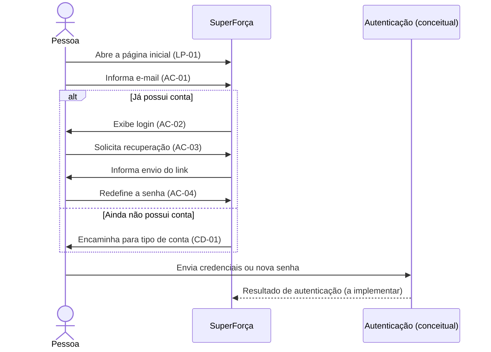

# Entrada e acesso

Fluxo comum aos dois perfis: apresenta o serviço, identifica o e-mail e encaminha
para login, recuperação de senha ou cadastro.

## Sequência

O participante de autenticação representa o comportamento esperado do produto,
não uma integração implementada neste repositório. O Figma inclui estados de
senha incorreta, acesso bloqueado e link expirado.

## Telas e estados

| ID no Figma | Tela |
|---|---|
| `4:16` | LP-01 — Página inicial |
| `18:872` | AC-01 — Identificação por e-mail |
| `21:988` | AC-02 — Login |
| `52:1830` | AC-02 — Senha incorreta |
| `52:1861` | AC-02 — Acesso bloqueado |
| `52:1759` | AC-03 — Link de recuperação enviado |
| `52:1781` | AC-04 — Redefinição de senha |
| `52:1811` | AC-04 — Link expirado |

## Siglas

- **LP:** landing page, ou página inicial de apresentação.
- **AC:** acesso e autenticação.
- **CD:** cadastro.

Os IDs correspondem aos nós do [arquivo-fonte](../../index.fig). O protótipo
online começa em [AC-01](https://www.figma.com/design/sucf2wudh5FRUMSHeWhfTi/SuperFor%C3%A7a-%E2%80%94-Telas-do-MVP?node-id=18-872).
