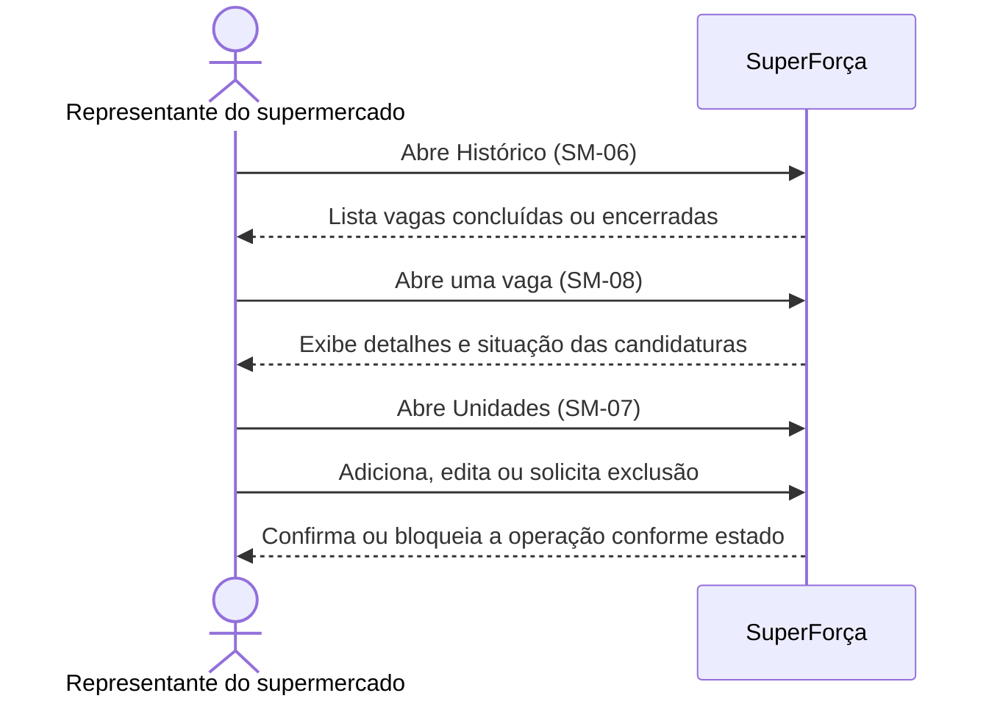

# Supermercado: histórico e unidades

Reúne a consulta de oportunidades concluídas, encerradas ou expiradas e a
manutenção das unidades da empresa. São áreas relacionadas do perfil, mas não
uma sequência obrigatória entre si.

## Sequência

## Telas e estados

| ID no Figma | Tela |
|---|---|
| `12:553`, `115:3914`, `115:4020` | SM-06 — Histórico geral, concluídas e encerradas |
| `12:632`, `93:3304` | SM-08 — Detalhe no histórico e vaga expirada |
| `117:4299`, `117:4417` | SM-08 — Detalhes de vaga normal e expirada |
| `117:4011`, `117:4107`, `117:4203` | SM-08 — Compareceram, faltaram e não selecionados |
| `13:682`, `119:4212`, `119:4310` | SM-07 — Unidades, adicionar e unidade adicionada |
| `13:748`, `13:833`, `118:4164` | SM-07 — Editar, excluir e exclusão bloqueada |

## Siglas e comportamentos

- **SM:** supermercado.
- **A registrar** e **expirada** são situações distintas de encerramento; os
  estados de comparecimento mostram o resultado do serviço.
- Uma exclusão de unidade pode ser bloqueada; o protótipo não define, por si só,
  todas as regras de dependência entre unidade e vagas.
- A conta e o suporte da empresa estão em
  [outra jornada](../05-conta-supermercado/).

Veja a [seção no arquivo-fonte](../../index.fig) ou o
[protótipo](https://www.figma.com/design/sucf2wudh5FRUMSHeWhfTi/SuperFor%C3%A7a-%E2%80%94-Telas-do-MVP?node-id=12-553).
