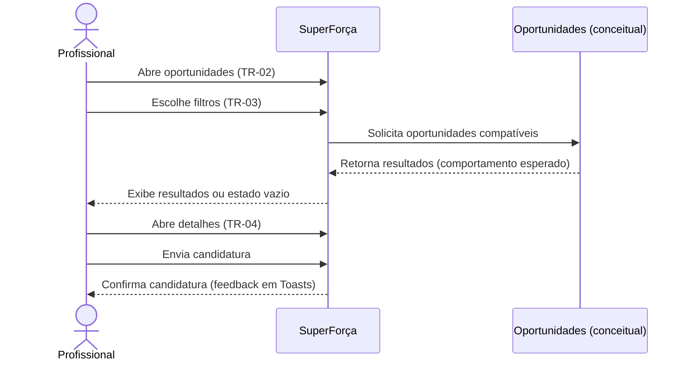

# Profissional: encontrar vagas e se candidatar

Descoberta de oportunidades, aplicação de filtros, consulta aos detalhes e envio
de candidatura. Convites e serviços resultantes estão na
[jornada seguinte](../08-convites-servicos-historico/).

## Sequência

## Telas e estados

| ID no Figma | Tela |
|---|---|
| `31:1246`, `33:1238`, `53:1834` | TR-02 — Oportunidades, resultados e sem resultados |
| `35:1322`, `54:1852`, `54:2037`, `54:2227`, `128:4352` | TR-03 — Filtros de função, data, horário, valor mínimo e distância |
| `128:4423`, `128:4551`, `128:4679`, `128:4807`, `128:4935` | TR-02 — Resultados com cada filtro aplicado |
| `35:1420` | TR-04 — Detalhes e candidatura |
| `132:4716` | TR-02 — Candidatura confirmada (seção de feedback) |

## Siglas e comportamentos

- **TR:** trabalhador/profissional.
- Filtros visíveis: função, distância, data, horário e valor mínimo.
- O pré-projeto prevê busca ampliada sem ocultar requisitos obrigatórios; o
  protótipo não documenta de forma suficiente a regra de compatibilidade e
  elegibilidade. Confirmar esse comportamento antes da implementação.
- Os dados de vaga publicados pelo supermercado são descritos em
  [publicar e preencher vagas](../03-publicar-preencher-vagas/).

Veja a [seção no arquivo-fonte](../../index.fig) ou o
[protótipo](https://www.figma.com/design/sucf2wudh5FRUMSHeWhfTi/SuperFor%C3%A7a-%E2%80%94-Telas-do-MVP?node-id=31-1246).
