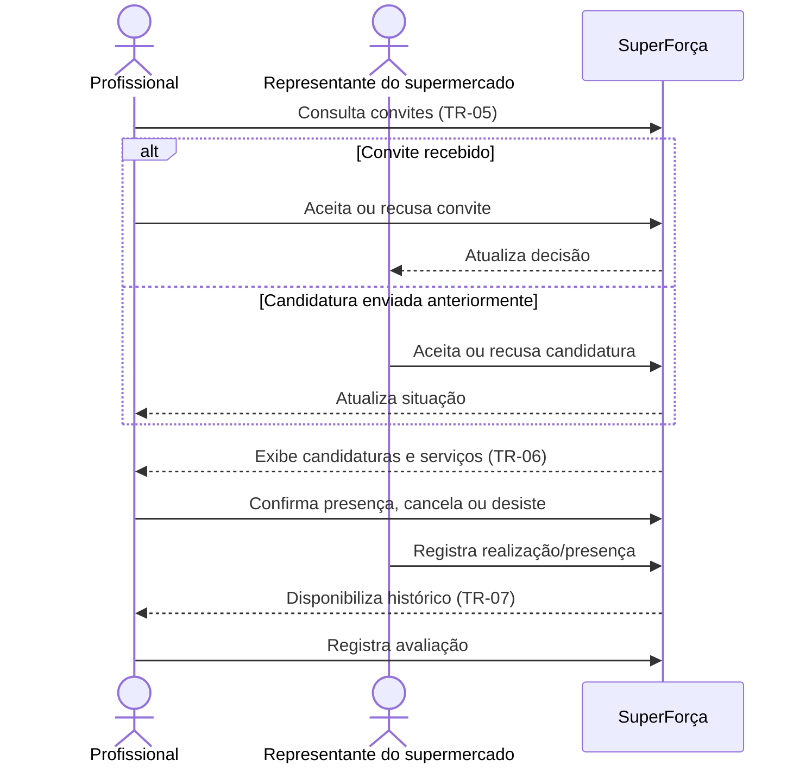

# Profissional: convites, serviços e histórico

Centraliza convites recebidos, candidaturas, confirmações de serviço, cancelamentos
e histórico/avaliações do profissional.

## Sequência

## Telas e estados

| ID no Figma | Tela |
|---|---|
| `36:1456`, `53:1910` | TR-05 — Convites recebidos; estado sem convites |
| `153:4890`, `153:4991` | TR-05 — Detalhes de convites |
| `36:1535`, `41:1668` | TR-06 — Candidaturas e detalhe da candidatura |
| `36:1636` | TR-06 — Serviços confirmados |
| `76:3113`, `76:3024` | TR-06/TR-07 — Aguardando registro |
| `100:3553` | TR-07 — Vaga cancelada |
| `37:1558` | TR-07 — Histórico e avaliações |

## Siglas e comportamentos

- **TR:** trabalhador/profissional.
- Convite aceito e candidatura selecionada levam a um serviço confirmado; são
  ações distintas.
- O Figma mostra confirmação de presença, desistência e cancelamento de
  candidatura como feedbacks. Regras de prazo, consequências e reabertura da
  vaga precisam ser definidas pelo produto.
- Pagamento ocorre fora da plataforma no escopo registrado no pré-projeto.

Veja a [seção no arquivo-fonte](../../index.fig) ou o
[protótipo](https://www.figma.com/design/sucf2wudh5FRUMSHeWhfTi/SuperFor%C3%A7a-%E2%80%94-Telas-do-MVP?node-id=36-1456).
