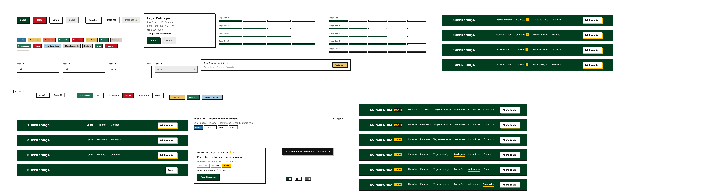
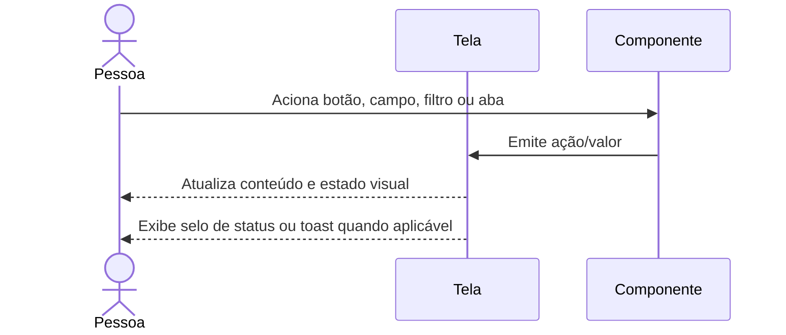

# Componentes

Inventário de elementos reutilizáveis que dão consistência às jornadas. Esta
seção não é uma jornada independente e, por isso, o diagrama mostra como os
componentes participam de uma interação genérica.

## Sequência de interação

## Elementos

19 frames/componentes de seção incluem botões, selos e dropdowns de status,
etiquetas, chips de filtro, abas, cabeçalhos, linhas de vaga, campos de
formulário, cards de profissional/unidade/oportunidade, controle de presença,
progresso de cadastro, chave e toast.

O cabeçalho administrativo e o cabeçalho do profissional têm variantes próprias.
Os componentes usam estados como primário, negativo, desabilitado, ativo,
inativo, bloqueado, presença registrada e diferentes situações de vaga/serviço.

## Siglas e comportamento

- **UI:** interface do usuário.
- Os nomes acima descrevem componentes presentes no Figma, não componentes
  implementados em código.
- Estados reutilizados são referências visuais; a documentação de cada jornada
  explica seu contexto de uso.

Consulte a [seção no arquivo-fonte](../../index.fig).
