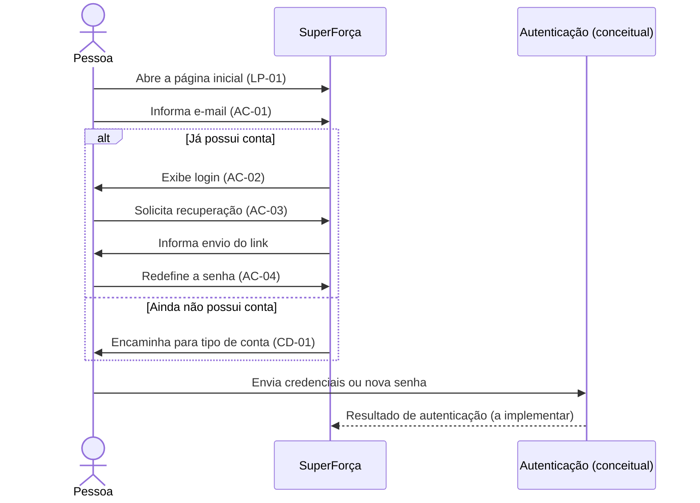

# Entrada e acesso

Fluxo comum aos dois perfis: apresenta o serviço, identifica o e-mail e encaminha
para login, recuperação de senha ou cadastro.

## Sequência

O participante de autenticação representa o comportamento esperado do produto,
não uma integração implementada neste repositório. O Figma inclui estados de
senha incorreta, acesso bloqueado e link expirado.

## Telas e estados

| ID no Figma | Tela | Exportação individual |
|---|---|---|---|
| `4:16` | LP-01 — Página inicial | [PNG](LP-01%20%C2%B7%20P%C3%A1gina%20inicial.png) |
| `18:872` | AC-01 — Identificação por e-mail | [PNG](AC-01%20%C2%B7%20Identifica%C3%A7%C3%A3o%20por%20e-mail.png) |
| `21:988` | AC-02 — Login | [PNG](AC-02%20%C2%B7%20Login.png) |
| `52:1830` | AC-02 — Senha incorreta | [PNG](AC-02%20%C2%B7%20Login%20%C2%B7%20Senha%20incorreta.png) |
| `52:1861` | AC-02 — Acesso bloqueado | [PNG](AC-02%20%C2%B7%20Login%20%C2%B7%20Acesso%20bloqueado.png) |
| `52:1759` | AC-03 — Link de recuperação enviado | [PNG](AC-03%20%C2%B7%20Link%20de%20recupera%C3%A7%C3%A3o%20enviado.png) |
| `52:1781` | AC-04 — Redefinição de senha | [PNG](AC-04%20%C2%B7%20Redefini%C3%A7%C3%A3o%20de%20senha.png) |
| `52:1811` | AC-04 — Link expirado | [PNG](AC-04%20%C2%B7%20Link%20expirado.png) |

## Siglas

- **LP:** landing page, ou página inicial de apresentação.
- **AC:** acesso e autenticação.
- **CD:** cadastro.

Os nomes dos PNGs correspondem aos frames no Figma; os IDs na tabela identificam
os nós no [arquivo-fonte](../../index.fig). O protótipo online começa em
[AC-01](https://www.figma.com/design/sucf2wudh5FRUMSHeWhfTi/SuperFor%C3%A7a-%E2%80%94-Telas-do-MVP?node-id=18-872).
