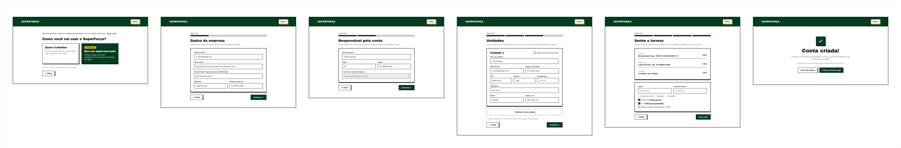
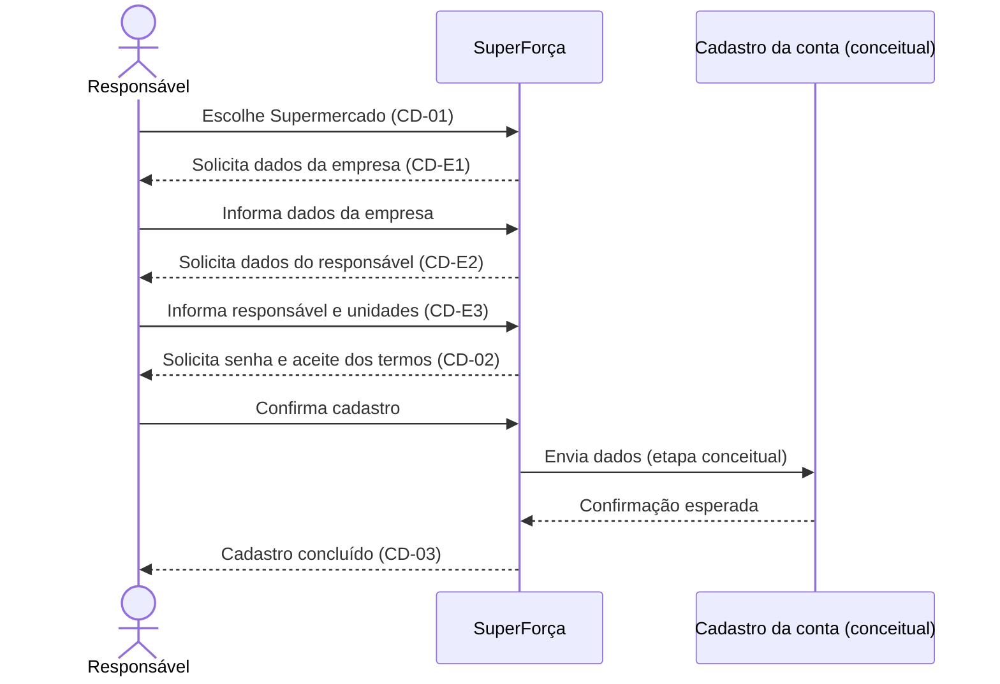

# Cadastro do supermercado

Cadastro progressivo da empresa, de seu responsável e das unidades. O fluxo
termina na definição de senha e na confirmação do cadastro.

## Sequência

## Telas

| ID no Figma | Tela |
|---|---|
| `18:891` | CD-01 — Tipo de conta |
| `18:916` | CD-E1 — Dados da empresa |
| `18:969` | CD-E2 — Responsável pela conta |
| `19:916` | CD-E3 — Unidades |
| `19:998` | CD-02 — Senha e termos |
| `19:1064` | CD-03 — Cadastro concluído |

## Siglas e comportamentos

- **CD:** cadastro; **E:** etapa do cadastro de empresa.
- A jornada é apresentada como uma sequência de etapas; dados persistidos,
  validação cadastral e confirmação por serviço externo não são implementados
  neste repositório.
- O cadastro do profissional está documentado em
  [outra jornada](../06-cadastro-profissional/).

Veja a [seção no arquivo-fonte](../../index.fig) ou o
[protótipo](https://www.figma.com/design/sucf2wudh5FRUMSHeWhfTi/SuperFor%C3%A7a-%E2%80%94-Telas-do-MVP?node-id=18-891).

Os PNGs individuais estão nesta pasta e começam com o ID do nó no Figma.
