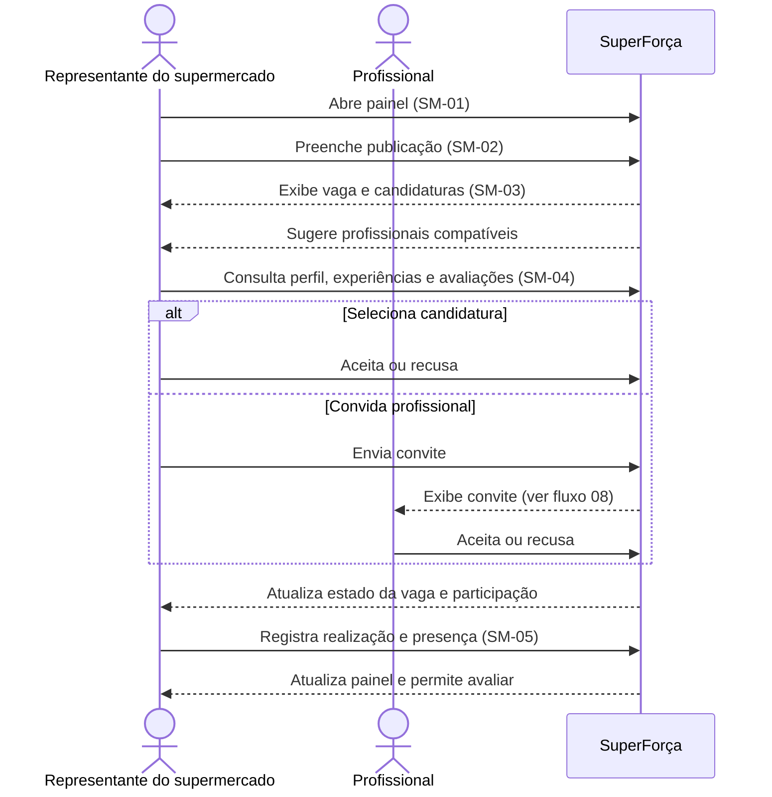

# Supermercado: publicar e preencher vagas

Jornada operacional do supermercado: publicar uma oportunidade, analisar
candidaturas e profissionais sugeridos, decidir a seleção e registrar a
realização do serviço.

## Sequência

## Telas e estados

| ID no Figma | Tela |
|---|---|
| `4:34`, `53:1783` | SM-01 — Painel de vagas; estado sem vagas |
| `5:121`, `76:2842` | SM-02 — Publicar vaga; modal bloqueado |
| `7:240`, `7:313`, `7:422` | SM-03 — Detalhes, candidaturas e sugeridos |
| `9:383`, `191:5731` | SM-03 — Editar e encerrar vaga |
| `11:496`, `11:562`, `11:613` | SM-04 — Perfil, experiências e avaliações |
| `9:531` | SM-05 — Realização |
| `76:2722` | SM-01 — Registro pendente |
| `93:3435` | SM-01 — Aviso de vaga concluída |
| `113:3769`, `113:3908`, `113:4019` | SM-01 — Vagas abertas, preenchidas e a registrar |

## Siglas e comportamentos

- **SM:** supermercado; os números identificam áreas/telas do perfil.
- Sugestões e candidaturas são caminhos alternativos para chegar à seleção.
- **A registrar** indica que a realização/presença ainda requer registro. A
  presença e o pagamento efetivo são conceitos distintos; o pagamento é externo
  à plataforma no escopo descrito no pré-projeto.
- Histórico e gestão das unidades ficam em
  [outra jornada](../04-historico-unidades/); conta e suporte em
  [conta do supermercado](../05-conta-supermercado/).

Consulte a [seção no arquivo-fonte](../../index.fig) ou o
[protótipo](https://www.figma.com/design/sucf2wudh5FRUMSHeWhfTi/SuperFor%C3%A7a-%E2%80%94-Telas-do-MVP?node-id=4-34).

Os PNGs individuais desta pasta usam o nome exato de cada frame do Figma.
