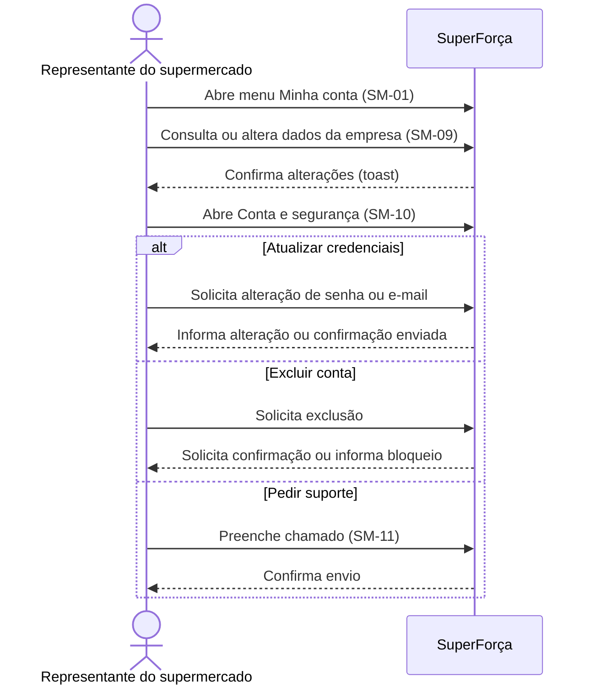

# Supermercado: minha conta

Área de consulta e manutenção de dados da empresa e segurança da conta, com
acesso ao suporte.

## Sequência

## Telas e estados

| ID no Figma | Tela |
|---|---|
| `59:2291` | SM-01 — Menu Minha conta aberto |
| `59:2359`, `59:2451` | SM-09 — Dados da empresa; SM-10 — Conta e segurança |
| `198:6093`, `198:6192` | SM-10 — Alterar senha e e-mail |
| `198:6376`, `198:6456` | SM-10 — Excluir conta; exclusão bloqueada |
| `208:6480` | SM-11 — Suporte |
| `208:6572` | SM-11 — Chamado enviado |

## Siglas e comportamentos

- **SM:** supermercado.
- A confirmação da alteração de e-mail representa o envio de uma confirmação,
  não prova que o endereço foi verificado.
- **Chamado** é uma solicitação de suporte; o tratamento administrativo aparece
  na [jornada do administrador](../10-administrador/).

Veja a [seção no arquivo-fonte](../../index.fig) ou o
[protótipo](https://www.figma.com/design/sucf2wudh5FRUMSHeWhfTi/SuperFor%C3%A7a-%E2%80%94-Telas-do-MVP?node-id=59-2359).

Os PNGs individuais desta pasta usam o nome exato de cada frame do Figma.
