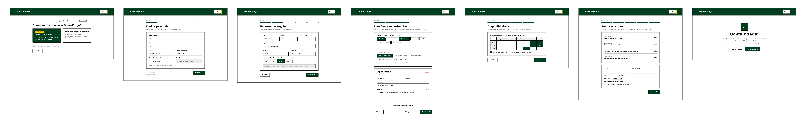
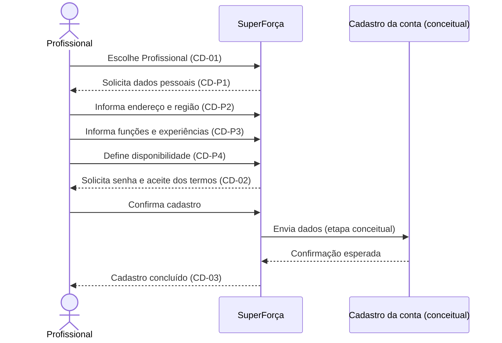

# Cadastro do profissional

Cadastro em etapas do perfil profissional, endereço/região, funções, experiências
e disponibilidade. A criação da senha e a conclusão seguem o fluxo comum de
cadastro.

## Sequência

## Telas

| ID no Figma | Tela |
|---|---|
| `26:1001` | CD-01 — Tipo de conta, opção profissional |
| `26:1026` | CD-P1 — Dados pessoais |
| `26:1085` | CD-P2 — Endereço e região |
| `27:1077` | CD-P3 — Funções e experiências |
| `75:2572` | CD-P4 — Disponibilidade |
| `27:1155` | CD-02 — Senha e termos |
| `27:1221` | CD-03 — Cadastro concluído |

## Siglas e comportamentos

- **CD:** cadastro; **P:** etapa do cadastro de profissional.
- Perfil, qualificação e disponibilidade contribuem para a descoberta de
  oportunidades, mas as regras de compatibilidade não são especificadas pelo
  protótipo.
- A [jornada de acesso](../01-entrada-acesso/) inicia o cadastro; a [área da
  conta profissional](../09-conta-profissional/) permite revisar perfil e
  segurança.

Veja a [seção no arquivo-fonte](../../index.fig) ou o
[protótipo](https://www.figma.com/design/sucf2wudh5FRUMSHeWhfTi/SuperFor%C3%A7a-%E2%80%94-Telas-do-MVP?node-id=26-1026).

Os PNGs individuais desta pasta usam o nome exato de cada frame do Figma.
