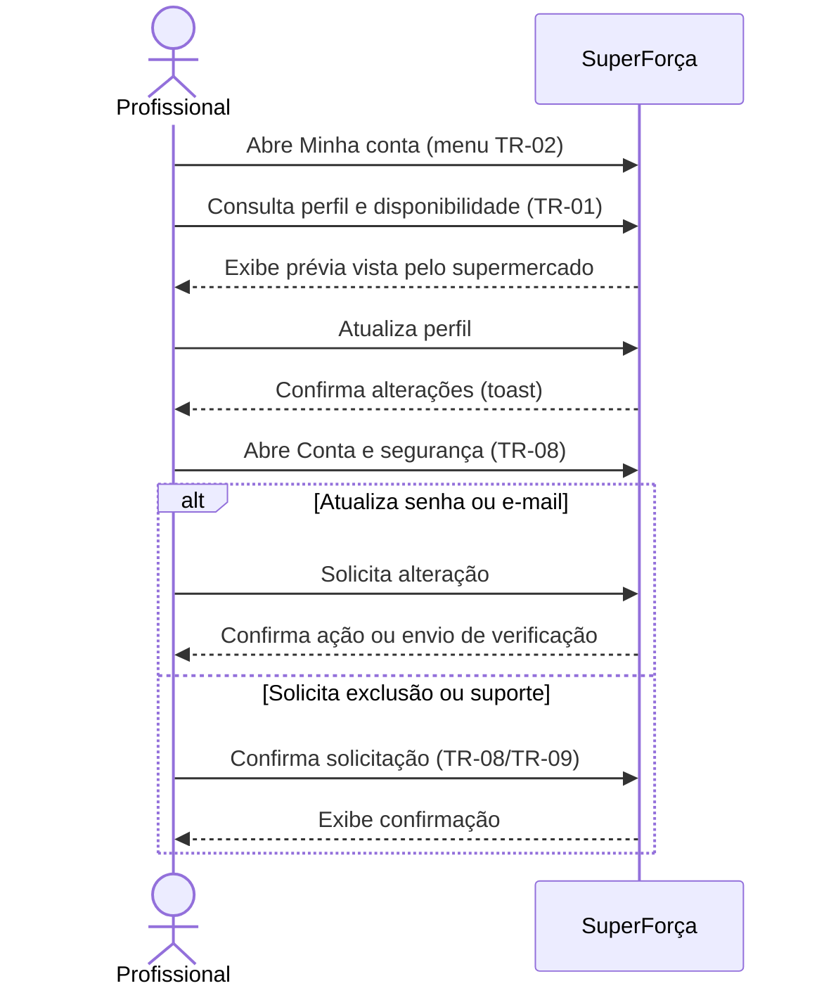

# Profissional: minha conta

Permite revisar o perfil e a prévia exibida ao supermercado, ajustar segurança e
acessar suporte.

## Sequência

## Telas e estados

| ID no Figma | Tela |
|---|---|
| `56:2167` | TR-02 — Menu Minha conta aberto |
| `37:1638` | TR-01 — Perfil e disponibilidade |
| `42:1658`, `44:1690`, `44:1775` | TR-01 — Prévia para o supermercado: detalhes, experiências e avaliações |
| `56:2243` | TR-08 — Conta e segurança |
| `181:5577`, `181:5682` | TR-08 — Alterar senha e e-mail |
| `198:6537` | TR-08 — Excluir conta |
| `208:6636` | TR-09 — Suporte |
| `208:6751` | TR-09 — Chamado enviado |

## Siglas e comportamentos

- **TR:** trabalhador/profissional.
- A prévia torna explícito que dados de perfil serão apresentados ao
  supermercado; privacidade e visibilidade de cada campo devem ser confirmadas.
- A confirmação de e-mail não equivale à conclusão de verificação. A exclusão
  aparece como solicitação, sem detalhar retenção ou consequências.
- Chamados e respostas são geridos pela [área administrativa](../10-administrador/).

Veja a [seção no arquivo-fonte](../../index.fig) ou o
[protótipo](https://www.figma.com/design/sucf2wudh5FRUMSHeWhfTi/SuperFor%C3%A7a-%E2%80%94-Telas-do-MVP?node-id=37-1638).

Os PNGs individuais estão nesta pasta e começam com o ID do nó no Figma.
