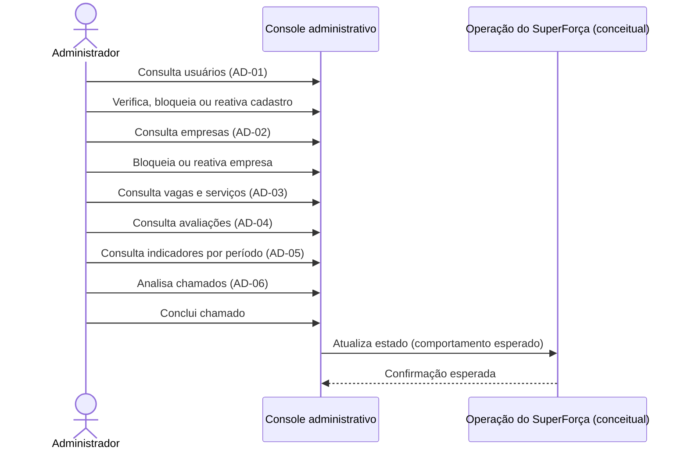

# Administrador

Área de operação e moderação: usuários, empresas, vagas/serviços, avaliações,
indicadores e chamados de suporte. O Figma inclui seis áreas administrativas,
incluindo AD-06 (chamados).

## Sequência

## Telas e estados

| ID no Figma | Tela |
|---|---|
| `77:3593`, `77:3783` | AD-01 — Usuários; AD-02 — Empresas |
| `77:3955`, `77:4146`, `77:4359` | AD-03 — Vagas e serviços; AD-04 — Avaliações; AD-05 — Indicadores |
| `78:3093`, `78:3228`, `203:6279` | Detalhes de usuário, empresa e vaga |
| `164:5043`–`164:5790` | Estados exemplificados de usuário: bloqueado, reativado e verificado |
| `165:5303`–`165:5954` | Estados exemplificados de empresa: bloqueada, reativada e CNPJ conferido |
| `171:5511`, `171:5664`, `171:5817` | AD-05 — Últimos 7 dias, trimestre atual e ano |
| `209:6642`, `209:6804`, `209:6972` | AD-06 — Chamados, detalhe e chamado concluído |
| `210:7076`, `210:7187` | AD-06 — Chamados abertos e concluídos |

## Siglas e comportamentos

- **AD:** administrador.
- Bloqueio e reativação de usuários/empresas são ações diferentes; telas de
  confirmação e resultados estão representadas.
- AD-06 trata chamados, incluindo exemplo relacionado a avaliação injusta.
- O Figma não define completamente papéis/permissões, trilha de auditoria,
  critérios de moderação, conteúdo dos indicadores nem níveis de serviço do
  suporte. Esses pontos precisam de decisão de produto.
- O detalhamento do protótipo usa dados de exemplo; não são registros reais.

Veja a [seção no arquivo-fonte](../../index.fig) ou o
[protótipo](https://www.figma.com/design/sucf2wudh5FRUMSHeWhfTi/SuperFor%C3%A7a-%E2%80%94-Telas-do-MVP?node-id=77-3593).

Os PNGs individuais desta pasta usam o nome exato de cada frame do Figma.
