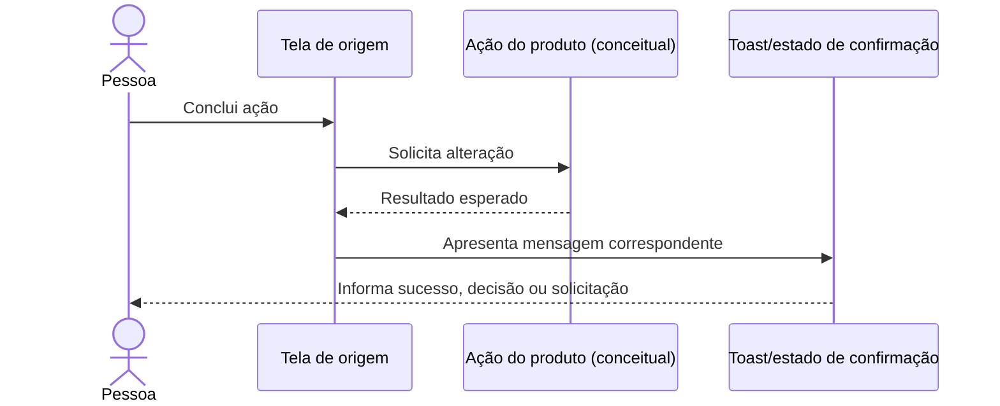

# Toasts e confirmações

Estados de retorno visual após ações realizadas em outras jornadas. Não são um
fluxo independente nem substituem telas de validação, erro ou confirmação quando
uma decisão exige atenção do usuário.

## Sequência

## Cobertura

São 25 frames associados a ações como candidatura confirmada/cancelada, convite
aceito/recusado/enviado, presença confirmada, desistência, vaga atualizada ou
encerrada, dados salvos, alterações de credenciais, exclusão solicitada,
avaliação enviada e chamado enviado.

Os estados estão agrupados por área de origem na própria exportação. Para
interpretar cada ação e seus próximos passos, consulte os índices das jornadas:
[supermercado](../03-publicar-preencher-vagas/),
[serviços do profissional](../08-convites-servicos-historico/) e
[contas/suporte](../05-conta-supermercado/).

## Siglas e comportamento

- **Toast:** notificação breve, normalmente não bloqueante.
- Uma mensagem de sucesso no protótipo não comprova persistência, entrega de
  notificação ou execução de integração.
- O Figma apresenta feedback positivo e decisões, mas não substitui a definição
  de erros de rede, falhas de validação, repetição segura e estados de carregamento.

Consulte a [seção no arquivo-fonte](../../index.fig).

Os PNGs individuais desta pasta usam o nome exato de cada frame do Figma.
